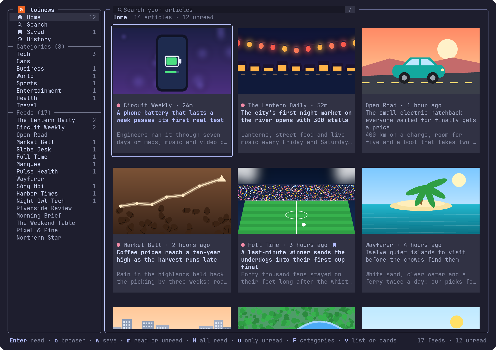

<div align="center">

# tuinews

**The news at the speed of your keyboard.**

A terminal RSS reader (TUI) laid out like a news site: a sidebar of your sources, a grid of article cards with their real pictures, and a reader that brings each article's whole text into the terminal.<br>
Arrow keys or vim keys. No account, no tracking, nothing but the feeds you read.

[](https://github.com/erictran308/tuinews/actions/workflows/ci.yml)
[](https://crates.io/crates/tuinews)
[](LICENSE)
[](https://www.rust-lang.org)

**[Get started](#get-started)** · **[Keys](#keys)** · **[Videos](#videos)** · **[Settings](#settings)** · **[Privacy](#privacy-and-security)**



<sub>Made-up news sites and articles, drawn by <code>tools/hero.py</code></sub>

</div>

---

## Why tuinews

- **Looks like a news site.** Home (every feed's newest), Search, Saved and History in the sidebar, then your categories, then your feeds, each with what you haven't read. Articles in a grid of cards: the picture, the source and how long ago, the title, the start of the summary. A red dot marks what you haven't read.
- **Vietnam's news, or only your own feeds.** The first time it starts, tuinews asks whether to start with the biggest Vietnamese news sites: VnExpress, Tuổi Trẻ, Thanh Niên, Dân Trí, VietnamNet, VTC News, Tiền Phong, VietnamPlus, Nhân Dân, Sài Gòn Giải Phóng, CafeF, GenK, Kenh14, and VnExpress International and Tuoi Tre News in English. Say no (`n`) and it starts with no feeds, for your own. `a` adds any feed, `x` removes one.
- **Your feeds, in and out.** Coming from Feedly, Inoreader, NetNewsWire or another reader? Export your feeds as OPML, press `a` and give the file's path (or drop the file on the terminal): its feeds come in under Feeds, its folders as categories. `tuinews --export feeds.opml` takes yours out again, for another reader or to keep.
- **Categories: only what you're into.** Vietnam's news comes with Tech, Cars, Business, World, Sports, Entertainment, Health and Travel, each made of the big sites' own sections (VnExpress's Xe, Tuổi Trẻ's Công nghệ, Dân Trí's Ô tô xe máy…, 47 in all), so Cars is car news from seven papers, and nothing else. The sections show only in their categories, not in Home. `F` puts a feed in categories or takes it out, makes one (`n`), renames (`r`) or deletes one (`x`); `a` in a category adds a feed straight into it.
- **Read here.** `Enter` opens the article in a popup that fades in over the dimmed page (`Esc` closes it): its picture beside its title, source and date, then its whole text with its pictures in their places, read from its page the way a browser's reader view does it (or from the feed, when it carries the whole article). `j k`, `Space` and `b` scroll, the pictures a row at a time; `]` and `[` go to the next article and the one before. `o` opens it in your browser.
- **Videos in the article.** A news site's own videos (VnExpress, Thanh Niên, Dân Trí, VTC News, Kenh14, GenK…) show in their places, as their pictures. `Enter` plays one, `f` makes it fill the screen. In [Pepper](#videos), it plays right there in the article, inside the terminal; anywhere else, in mpv's window.
- **Arrows or vim, your choice.** `←↓↑→` and `h j k l` both move, `gg` / `G`, `Ctrl-d` / `Ctrl-u`, `PgUp` / `PgDn`. They move in the pane you're in; `Ctrl` with an arrow or `h j k l` goes to the pane that way. `?` lists every key, `O` opens the settings.
- **Search without accents.** `/` searches the articles you have: `ha noi` finds Hà Nội, `da nang` finds Đà Nẵng.
- **Read, unread, saved.** Opening an article marks it read (`m` marks it unread again, `M` marks all shown read). `u` shows only what you haven't read, and what you read stays in view until you leave. `w` keeps an article in Saved for as long as you like.
- **Real pictures.** Full pictures in Ghostty, kitty, WezTerm and iTerm2 (sixel terminals too), block-character previews in any other terminal, or `v` for a list without pictures.
- **Gentle on the sites.** Each feed is fetched again only when it's more than 15 minutes old, with the last answer's ETag and date so an unchanged feed costs a few bytes. A site that asks tuinews to slow down isn't asked again for an hour. An article's page is fetched only when you open it, and kept.
- **Make it yours.** Catppuccin, Tokyo Night, Dracula, Gruvbox, Nord and Rosé Pine themes, Nerd Font icons where your terminal has them, and card, sidebar and reader widths to taste.

## Get started

**1. Install it.** If you have Rust and [cargo-binstall](https://github.com/cargo-bins/cargo-binstall), that's one command, on any system:

```sh
cargo binstall tuinews
```

Otherwise, on macOS or Linux, paste this into a terminal. It puts `tuinews` in `~/.local/bin`:

```sh
mkdir -p ~/.local/bin
curl -fsSL https://github.com/erictran308/tuinews/releases/latest/download/tuinews-aarch64-apple-darwin.tar.gz | tar xz -C ~/.local/bin tuinews
```

Swap the file name for your computer's:

| Computer | File |
| --- | --- |
| Mac with Apple silicon (M1 or later) | [`tuinews-aarch64-apple-darwin.tar.gz`](https://github.com/erictran308/tuinews/releases/latest/download/tuinews-aarch64-apple-darwin.tar.gz) |
| Mac with Intel | [`tuinews-x86_64-apple-darwin.tar.gz`](https://github.com/erictran308/tuinews/releases/latest/download/tuinews-x86_64-apple-darwin.tar.gz) |
| Linux, x86_64 | [`tuinews-x86_64-unknown-linux-musl.tar.gz`](https://github.com/erictran308/tuinews/releases/latest/download/tuinews-x86_64-unknown-linux-musl.tar.gz) |
| Linux, ARM64 | [`tuinews-aarch64-unknown-linux-musl.tar.gz`](https://github.com/erictran308/tuinews/releases/latest/download/tuinews-aarch64-unknown-linux-musl.tar.gz) |
| Windows, x86_64 | [`tuinews-x86_64-pc-windows-msvc.zip`](https://github.com/erictran308/tuinews/releases/latest/download/tuinews-x86_64-pc-windows-msvc.zip) |
| Windows, ARM64 | [`tuinews-aarch64-pc-windows-msvc.zip`](https://github.com/erictran308/tuinews/releases/latest/download/tuinews-aarch64-pc-windows-msvc.zip) |

- **Windows:** download the `.zip`, unzip it, and run `tuinews.exe` from Windows Terminal.
- **Linux:** any distribution: the binary is static, with nothing of the system's to link.
- **macOS:** if you downloaded the file in a browser instead, macOS blocks the app. Run `xattr -d com.apple.quarantine tuinews` once to allow it.

If `tuinews` isn't found afterwards, add `~/.local/bin` to your `PATH`. Each file comes with a signed record of the commit it was built from; to check one, run `gh attestation verify <file> --repo erictran308/tuinews`. `SHA256SUMS` in the release has each file's SHA-256.

**Or build it from source** (Rust 1.90 or newer, and a C compiler for the SQLite and TLS code built into tuinews: `xcode-select --install` on macOS, `build-essential` or your system's `gcc` on Linux, the Visual Studio Build Tools that rustup offers on Windows):

```sh
cargo install tuinews --locked
```

Or the newest from GitHub:

```sh
cargo install --git https://github.com/erictran308/tuinews --locked
```

If a `tuinews` Cargo built isn't found afterwards, add `~/.cargo/bin` to your `PATH`.

**2. Run it.**

```sh
tuinews
```

Any terminal works; Ghostty, kitty, WezTerm and iTerm2 show the articles' real pictures (see [Pictures and icons](#pictures-and-icons)).

The first time, tuinews asks what to start with: `y` for Vietnam's news sites and the categories made of their sections, some 60 feeds (Home fills up within a few seconds, the categories within a dozen), or `n` for no feeds. To add a feed, press `a` and type or paste its address, or just a site's (`genk.vn`): tuinews finds the feed the site's page names. To bring yours from another reader, export them as OPML and give `a` the file's path (`~/Downloads/feeds.opml`).

### Categories

Open one in the sidebar (under **Categories**) to see only its articles, newest first. A category's articles come from its feeds: the sites' sections it starts with, and any of your feeds you put in it.

- **A feed into a category:** `F` on it in the sidebar (or on one of its articles), then `Enter` on the category. A feed can be in several.
- **A new feed, only in a category:** open the category, press `a` and give the feed's address. It shows there and nowhere else.
- **A new category:** `F`, then `n`, and type its name. `r` renames one, `x` deletes one (the sections only it had go with it; your feeds stay).

### Check your setup

```sh
tuinews --check
```

It says where your data is, how many feeds you have and which failed, the proxy in use, how your terminal draws pictures, and where videos play (the mpv found, and whether this is Pepper).

## Keys

The status bar shows the keys for where you are, and `?` lists them all. `Tab` there goes to the settings.

| Key | Action |
| --- | --- |
| `←↓↑→` / `h j k l` | Move, in the pane you're in. In the cards, right from a row's last goes to the next row's first |
| `Ctrl` + `←↓↑→` / `h j k l` | To the pane that way: `Ctrl-h` the sidebar, `Ctrl-l` the articles, `Ctrl-k` the search box, `Ctrl-j` from it to the articles |
| `Tab` / `Esc` | Sidebar ↔ articles |
| `gg` / `G`, `Home` / `End` | First / last |
| `PgUp` / `PgDn`, `Ctrl-u` / `Ctrl-d` | A page / half a page |
| `Enter` | Read the article here; in the sidebar, open the feed or view |
| `o` / `y` | Open the article in your browser / copy its link |
| `w` | Save it in Saved, or take it off, after you press `y` |
| `m` / `M` | Read or unread / mark every article shown read (after you press `y`) |
| `u` | Only unread articles, or all |
| `x` | Take the article off Saved or History; in the sidebar, remove the feed or delete the category. Each asks first: `y` does it, any other key doesn't |
| `F` | Categories: put the feed (the sidebar's, or the article's) in some or take it out (`Enter`), make one (`n`), rename one (`r`) or delete one (`x`, after you press `y`) |
| `v` | A list (two rows an article, no pictures) or cards |
| `/` or `s` | Search your articles (`Enter` searches, `Esc` cancels) |
| `a` | Add a feed: its address, or a site's that names one; in a category, into it (and only there). Or an OPML file's path, in any view: its feeds under Feeds, its folders as categories. A link pasted with no box open goes in this box |
| `R` | Fetch every feed now |
| `Backspace` / `Ctrl-o` | Back to the view before |
| `?` / `O` | Every key / the settings |
| `q` | Quit (in the reader, back to the articles) |

In a box you type in (a search, a feed's address, a category's name): `←` `→` move a letter, `Option` / `Alt` with them a word, `Home` / `End` or `Cmd-←` / `Cmd-→` (`Ctrl-a` / `Ctrl-e`) to either end; `Backspace` and `Delete` delete a letter, `Ctrl-w` or `Option-Backspace` the word before, `Ctrl-u` or `Cmd-Backspace` all before.

In the reader: `j k` scroll a line, `Space` / `b` a page, `g` / `G` the top and the end, `]` / `[` the next article and the one before, `o` (or `Enter`, with no video shown) the browser, `w` save, `m` unread, `y` copy the link, `Esc`, `q` or `Backspace` back.

With a video in the article: `Enter` plays the one shown (again to pause it, or plays another shown), `f` fills the screen with the one playing, `x` stops it. In Pepper's full screen, `Space` or `Enter` pauses, `←` `→` go 5 seconds, `↓` `↑` a minute, `f`, `Esc` or `q` go back to the article. With none playing, `f` is a page down, as always.

## Videos

A video in an article (in its text, or the one a video page plays above it) shows in its place as its picture, with a line under it: `▶ Video · Enter plays it`. tuinews finds a site's own videos: those its page plays itself, as a file or an HLS stream, over https. One from YouTube or another site's player isn't one of them: `o` opens the article in your browser.

**In [Pepper](https://github.com/erictran308/pepper)**, a Ghostty build that shows video inside the terminal, the video plays in the article, where its picture was, through Pepper's own player, `pepper-play` (it comes inside Pepper, and needs Homebrew's mpv: `brew install mpv`). Scroll on and it goes to a small box in the reader's corner, still playing; `f` makes it fill the tab, with the time and the keys on the last row, and ⌘↩ makes Pepper's window full screen too. A popup over it (`?`) shows, and the video plays on around it (in an older Pepper, it hides while the popup is open). `inline_video = false` plays it in mpv's window, as anywhere else.

**Anywhere else** (another terminal, or Pepper through tmux, GNU screen or zellij), it plays in mpv's window, and the line under the video says how far it's played. `Enter` pauses it, `f` fills the screen, `x` stops it; mpv's own keys work in its window too. On Windows, tuinews only starts and stops it: use mpv's keys there. It needs mpv: `brew install mpv` (macOS), `winget install shinchiro.mpv` (Windows), or your package manager's.

The video stops when you leave its article. With a proxy set, videos don't play (see [Privacy and security](#privacy-and-security)); `o` opens the article in your browser. `tuinews --check` says where videos play.

## Settings

`O` (or `?` then `Tab`) opens the settings: summaries on the cards, the list, only unread, reading the whole article here, videos inside Pepper, History, animations and the theme. `j` / `k` move, `Enter` or `Space` turns one on or off, and it's saved at once, changing only its own line in `settings.toml` and keeping the rest of the file.

Everything else is in `settings.toml` in [your data folder](#your-data). Every line is optional; changes made by hand take effect the next time tuinews starts:

```toml
theme = "mocha"        # latte, frappe, macchiato, mocha, tokyonight, dracula, gruvbox, nord, rose-pine
animations = true      # the logo while tuinews starts, the screen fading in after, the reader fades in, popups open out over a dimmed screen
summaries = true       # the start of each summary on its card
list = false           # every view as a list, without pictures (v switches)
unread_only = false    # only the articles you haven't read (u switches)
full_text = true       # read an article's whole text from its page when you open it
inline_video = true    # in Pepper, play a video in the article (else in mpv's window)
history = true         # remember the articles you open, here only
refresh_minutes = 15   # how old a feed may get before it's fetched again (5 at least)
keep_days = 30         # how long articles are kept, unless saved or in History
blocked_words = []     # e.g. ["showbiz", "xổ số"]: whole words in a title, in any case
images = "auto"        # auto, kitty, sixel, iterm2 or blocks
icons = "auto"         # auto, nerd (Nerd Font icons) or plain
card_width = 32        # narrowest card, in columns
sidebar_width = 28
reader_width = 90      # widest the reader's text goes, in columns (its popup is 12 wider)
```

### Pictures and icons

tuinews asks your terminal how it draws pictures. Ghostty, kitty, WezTerm, iTerm2 and sixel terminals show real pictures; others get block-character previews. Inside tmux the question often doesn't reach the terminal: tuinews turns `allow-passthrough` on for its own pane while it runs, and puts the pane's old value back when it quits; `images = "kitty"` (or `TN_IMAGES=kitty`) draws them anyway when your terminal is Ghostty or kitty. A setting other than `auto` skips the question altogether.

News sites serve some pictures as AVIF, which tuinews doesn't decode; it asks for the JPEG, PNG or WebP they were made from (`a.jpg.avif` is `a.jpg`), which the sites serve too.

Icons are Nerd Font icons in Ghostty, kitty and WezTerm, which have them built in. If one shows as a box, set `icons = "plain"`.

## Privacy and security

- **No account, no tracking.** tuinews asks the sites for their feeds, the pictures on the cards you see, and the page of an article you open; a video's stream only when you play it. Nothing else is sent anywhere, and no cookie is ever kept.
- **Videos over https only.** mpv (or Pepper's pepper-play) starts with none of your mpv settings or scripts, checks certificates, runs no yt-dlp, and opens only the article's video: its stream, and an HLS stream's parts, all over https (a redirect to http is refused), never a file on your computer. tuinews checks the video's address as it checks any link; the redirects of its stream and the parts its playlist lists are followed by mpv itself, to whatever host they name, over https with certificates checked. mpv is controlled over a private channel only tuinews has, and on macOS and Linux nothing about the video is on its command line, which other users of the computer can read (on Windows, where tuinews can't talk to mpv yet, its address and title are; there other users can't read it). With a proxy set, videos don't play: an HLS stream's playlist can name a part that mpv fetches on its own, around the proxy, and tuinews won't go around your proxy.
- **Pictures over https only.** A picture is never asked for in the clear (which would tell the network what you read), nor from an address on your computer or network.
- **Links that are what they say.** Links and pictures from a feed, and an OPML file's feeds, are kept only if they're `http` or `https`, on a named host (not an IP address, `localhost` or `*.local`), with no user or password in them (`https://vnexpress.net@evil.example` reads as one site and goes to another). Redirects go only where a link could, never from https to http.
- **Text stays text.** Titles, summaries and articles' text are made plain text (no tags, scripts or links), cleaned of terminal escape codes and other characters that don't show, and capped in length, before they're kept or shown. A link in an article is text: nothing opens it. Pictures are decoded only as JPEG, PNG, WebP or GIF, within size limits, with a decoder's crash contained.
- **One route for everything.** If you use a proxy, every request goes through the same one: the first set of `https_proxy`, `HTTPS_PROXY`, `all_proxy`, `ALL_PROXY`, `http_proxy`, `HTTP_PROXY`. It must be an `http://` or `https://` proxy; tuinews refuses to start with another kind rather than go around it. Videos don't play with one (above). With none set, nothing uses a proxy, not even one in your system settings.
- **Your lists stay here.** Your feeds, what you've read, saved and opened, and your settings are in one folder readable only by you. `x` takes an article off Saved or History for good, wiped from the database file at once. `history = false` stops History.
- **Pastes stay text.** Pasted text only ever goes into the search or add box: a paste that arrives as keystrokes is never taken for commands.

To report a problem, see [SECURITY.md](SECURITY.md).

## Your data

Everything is in one folder on your machine (`tuinews --help` prints its path):

| OS | Location |
| --- | --- |
| macOS | `~/Library/Application Support/tuinews` |
| Linux | `~/.local/share/tuinews` |
| Windows | `%LOCALAPPDATA%\tuinews` |

It holds `tuinews.db` (your feeds and categories, their articles, what you've read, saved and opened, and articles' text once read), `settings.toml`, and a cache of pictures. Deleting it starts tuinews afresh: it asks again what to start with.

To keep your feeds and categories, or take them to another reader: `tuinews --export feeds.opml` writes them as OPML to a new file readable only by you (`tuinews --export` alone prints them). `a` in tuinews, given that file's path, brings them back, each in its categories again.

| Variable | Use |
| --- | --- |
| `TN_DATA_DIR` | Keep the data folder somewhere else (a full path) |
| `TN_IMAGES` | How pictures are drawn: `auto`, `kitty`, `sixel`, `iterm2` or `blocks` |
| `TN_ICONS` | Which icons: `auto`, `nerd` or `plain` |
| `TN_MPV` | The mpv that plays videos, if not the one on `PATH` |
| `TN_PEPPER_PLAY` | In Pepper, its `pepper-play`, if not where Pepper says (`PEPPER_PLAY`) |
| `https_proxy` and the like | The one proxy everything goes through (see [Privacy and security](#privacy-and-security)) |

## Development

```sh
cargo test                       # offline tests
cargo test -- --ignored live     # every default feed and section, and an article's text from every site
cargo clippy --all-targets
TN_DATA_DIR=$HOME/tn-test cargo run   # a separate data folder (a full path) for trying things
```

`docs/hero.png` is one frame of made-up news sites and articles (`src/hero.rs`), drawn by `tools/hero.py` (its first lines say how).

Copy `.env.example` to `.env` in the source folder for development settings. Only development builds read `.env`, and only from the source folder.

## Built with

- [ratatui](https://ratatui.rs), [ratatui-image](https://github.com/benjajaja/ratatui-image) and [tachyonfx](https://github.com/junkdog/tachyonfx)
- [reqwest](https://github.com/seanmonstar/reqwest) with rustls, [quick-xml](https://github.com/tafia/quick-xml), [scraper](https://github.com/rust-scraper/scraper) and [rusqlite](https://github.com/rusqlite/rusqlite)
- The layout, themes and safety rules of [tuitube](https://github.com/erictran308/tuitube), and with it [tuigram](https://github.com/erictran308/tuigram) and [tuimeta](https://github.com/erictran308/tuimeta)
- Colors from [Catppuccin](https://catppuccin.com), [Tokyo Night](https://github.com/folke/tokyonight.nvim), [Dracula](https://draculatheme.com), [Gruvbox](https://github.com/morhetz/gruvbox), [Nord](https://www.nordtheme.com) and [Rosé Pine](https://rosepinetheme.com)

## Disclaimer

tuinews is an unofficial, independent hobby project, not affiliated with or endorsed by any of the news sites it reads. Their names are used only to say which feeds it starts with; their articles and pictures are theirs. Read them on their sites too.

The software is provided "as is", without warranty of any kind. See the [MIT license](LICENSE) for the full terms.

## License

[MIT](LICENSE).
